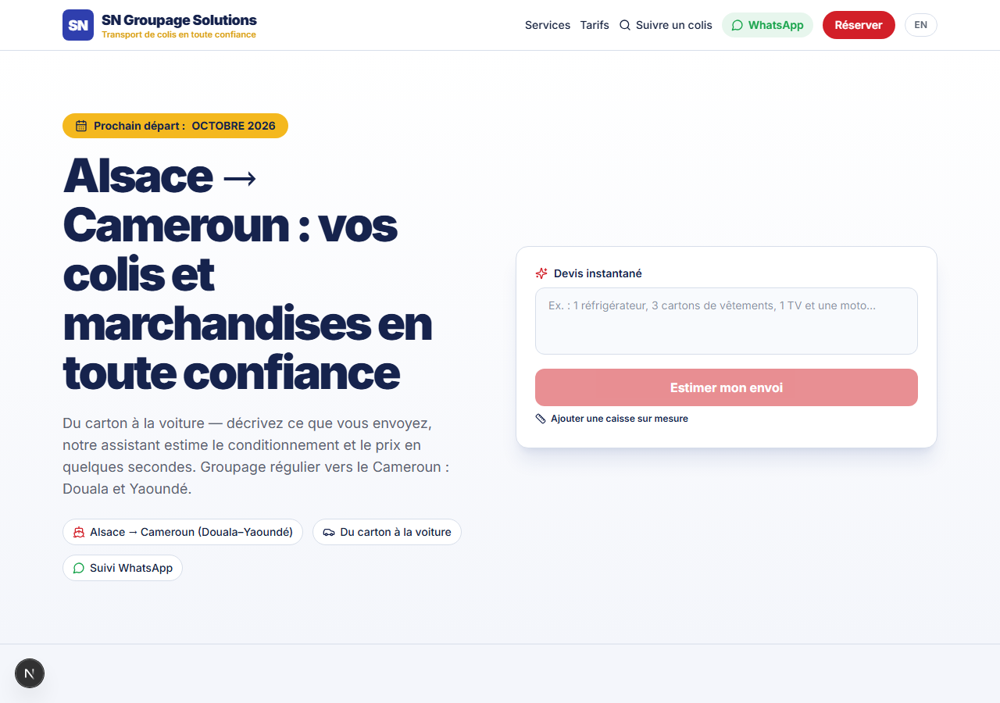
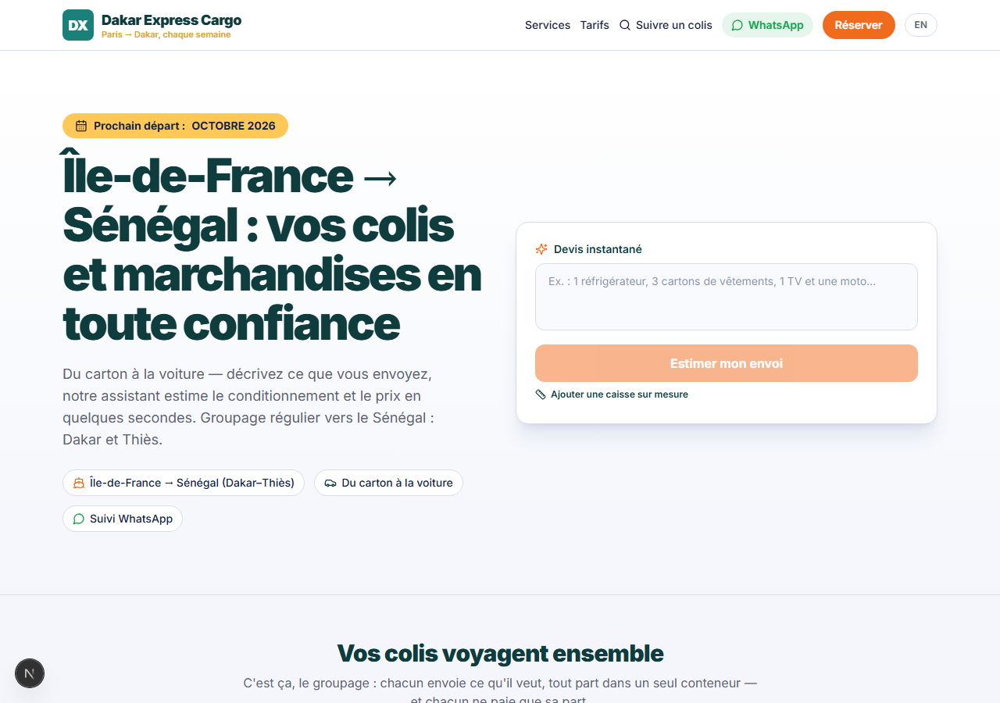

# FreightFlow

**A white-label, AI-assisted shipping platform for country-to-country freight companies — with hallucination-proof pricing.**

[](https://github.com/OWNER/freightflow/actions/workflows/ci.yml)
  

One codebase, one config file per client. The demo ships two tenants from the same build:

| Tenant | Lane | Prefix | Rate |
|---|---|---|---|
| **SN Groupage Solutions** (real brand) | Alsace → Cameroun (Douala–Yaoundé) | `SN-2026-…` | €750/m³ |
| **Dakar Express Cargo** (fictional) | Île-de-France → Sénégal (Dakar–Thiès) | `DX-2026-…` | €650/m³ |

<p align="center">
  
  
</p>

## Why this exists

Shipping companies on diaspora lanes (Europe → West/Central Africa) still quote by WhatsApp and run brochure websites. FreightFlow gives them an instant, *trustworthy* quote engine, a booking flow, branded tracking and an AI assistant — without the AI ever inventing a price.

**Built as a portfolio project. If you run a shipping lane and want this for your brand: it is one config file away.**

## What a customer gets

- **Instant quote** — describe items in plain French/English; the engine recognises them against a fixed catalog and prices them deterministically. *Same item, same price, every time.*
- **Custom dimensions** — measure a box, get an exact price. No AI involved.
- **Inline AI assistant** — closest-match suggestions, shipping FAQ, grounded in the tenant's real data; every number it shows comes from the pricing engine via a tool call.
- **5-step booking** with autosave, home-pickup pricing by real road distance (OSRM), consolidation calendar, branded parcel number.
- **Tracking page** with milestone timeline, passport-stamp check-ins, WhatsApp-first notifications; the shipping partner is never exposed (white-label scrub pipeline).
- **Public rate card** (`/tarifs`) and services page, bilingual FR/EN.
- **Optional Stripe Checkout** (test mode in the demo) — falls back to pay-at-terminal.
- **Ops panel** (`/admin`): weigh-in reconciliation, partner mapping, secure API-key field.

## AI guardrails (the part clients care about)

The AI is allowed to **classify and explain** — never to **price**.

| Guardrail | Where |
|---|---|
| AI returns catalog ids only; price is pure arithmetic | `src/lib/classify.ts`, `src/lib/pricing.ts` |
| Output validated against the catalog enum; unknown ids rejected | `src/lib/catalog/items.ts` |
| Low confidence / unmatched text → human quote, never a guess | `src/lib/classify.ts` |
| Assistant quotes only through the `price_items` tool | `src/lib/assist.ts` |
| Partner names scrubbed: deny-list → AI rewrite → re-scrub → template | `src/lib/sanitize.ts` |
| `SN_DISABLE_AI=1` kill-switch; secrets server-only, masked, never logged | `src/lib/secrets.ts` |
| Weigh-in repricing is explicit and versioned (>15% delta) | `src/app/api/admin/weigh-in/route.ts` |

Every guardrail has a test: see [`docs/AI-GUARDRAILS.md`](docs/AI-GUARDRAILS.md) and `src/lib/__tests__/`.

## Architecture

```
src/tenant/            tenant config: brand, lanes, rates, catalog, contacts, colours
src/lib/pricing.ts     pure quote engine — max(volume, weight/200) × rate, €-floor, vehicle flats
src/lib/classify.ts    text → catalog lines (AI classify-only, keyword fallback)
src/lib/assist.ts      grounded assistant (FAQ KB + tool-backed quotes)
src/lib/sanitize.ts    white-label anti-leak pipeline
src/lib/carrier/       CarrierAdapter + FakeCarrierAdapter (replays a leaky partner feed)
src/app/               Next.js 15 App Router: /, /book, /track, /tarifs, /services, /admin, /api/*
```

Stack: Next.js 15 · React 19 · TypeScript · Tailwind v4 · motion · SQLite (Drizzle) · Anthropic SDK · Stripe · vitest · Playwright.

## Run it

```bash
npm install
npm run dev                      # http://localhost:3004 — SN Groupage demo
NEXT_PUBLIC_FREIGHTFLOW_TENANT=dakar-express npm run dev   # second tenant
```

Optional env (see `.env.example`): `ANTHROPIC_API_KEY` (or paste it in `/admin`), `STRIPE_SECRET_KEY` (test), `SN_DISABLE_AI=1`.

```bash
npm run typecheck && npm test    # types + unit/guardrail tests
npm run test:e2e                 # Playwright: quote → booking → tracking → admin
```

## Add your own shipping company

1. Copy `src/tenant/tenants/dakar-express.ts` → `your-brand.ts`; fill brand, lane(s), rates, catalog overrides, contacts, colours.
2. Register it in `src/tenant/index.ts`.
3. Deploy with `NEXT_PUBLIC_FREIGHTFLOW_TENANT=your-brand`.

That's the whole onboarding.

## Roadmap

- W2: real carrier adapter (17TRACK/AfterShip), Twilio WhatsApp + email transports, customer order lookup, catalog/pricing editor in `/admin`, multi-lane booking.
- W3: per-lane SEO pages, legal pages (CGV/privacy), reviews, PWA, Lighthouse/a11y gates.

## License

MIT — demo tenant "Dakar Express Cargo" is fictional. "SN Groupage Solutions" brand assets belong to their owner.
